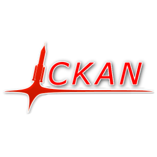
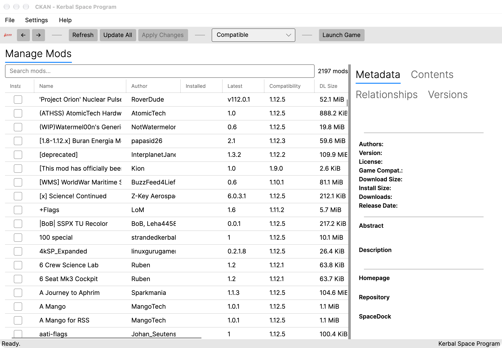
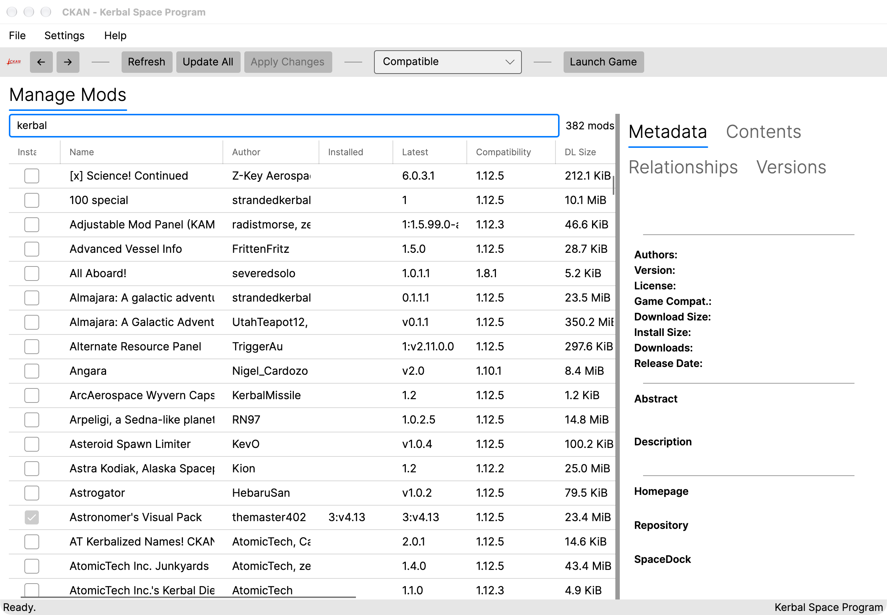

<div align="center">



# CKAN for macOS

**The Kerbal Space Program mod manager, rebuilt as a native Mac app.**

Find, install, update and remove KSP mods in a few clicks on Apple Silicon and Intel Macs, with automatic dependency resolution and no Terminal, Mono or Wine.

[](https://github.com/wjacobs20301/CKAN-MacOS/releases/latest)
[](https://github.com/wjacobs20301/CKAN-MacOS/releases)


[](LICENSE)

[**Download**](#download) · [**Using CKAN**](#using-ckan) · [**How it works**](#how-it-works) · [**FAQ**](#faq) · [**Build from source**](#building-from-source)

<br />



</div>

---

## ✨ Why CKAN for macOS?

[CKAN (the Comprehensive Kerbal Archive Network)][upstream] is the standard mod manager for **Kerbal Space Program**. On macOS, getting it running used to mean installing Mono and launching it from Terminal, and the result was a Windows Forms UI that didn't feel at home on a Mac.

This fork packages CKAN as a **proper Mac application**:

| | |
|---|---|
| 🖥️ **Native app** | Double-click `CKAN.app` like any other Mac app. No Terminal, Mono or Wine. |
| ⚡ **Universal binary** | Runs natively on **Apple Silicon (M1/M2/M3/M4)** and **Intel** Macs. |
| 🔍 **Retina-ready UI** | A modern [Avalonia][avalonia] interface that's sharp on high-DPI displays. |
| 📦 **Drag-and-drop install** | Ships as a styled `.dmg`: drag to Applications and you're done. |
| 🔗 **Dependency resolution** | Installs every mod's requirements automatically and warns you about conflicts. |
| 🔔 **Update notifications** | Checks GitHub Releases and tells you when a new version is out. It never installs updates silently. |
| ♻️ **Painless migration** | Picks up your existing CKAN data from an older Mono-based install automatically. |
| 💾 **Saves disk space** | Downloaded mod archives are deleted after install rather than kept in a cache. |

<a id="download"></a>

## 📥 Download & install

> **Requirements:** macOS 11 Big Sur or later · Apple Silicon or Intel · a copy of Kerbal Space Program (Steam, GOG or the standalone version)

1. Download **`CKAN.dmg`** from the [**latest release**][releases].
2. Open the DMG and drag **CKAN.app** into your **Applications** folder.
3. Launch CKAN from Applications or Launchpad.

### First launch: getting past Gatekeeper

The app isn't notarized by Apple yet, so the first time you open it macOS may say *"CKAN can't be opened"* or *"Apple could not verify CKAN"*. To allow it:

1. Try to open CKAN once, then click **Done** or **Cancel** on the warning.
2. Open **System Settings → Privacy & Security**, scroll down, and click **Open Anyway** next to the CKAN message.
3. Confirm with your password or Touch ID. After that, CKAN opens normally.

If you're comfortable with Terminal, this does the same thing:

```bash
xattr -dr com.apple.quarantine /Applications/CKAN.app
```

### Pointing CKAN at your game

On first run, CKAN asks where Kerbal Space Program is installed. Typical locations on a Mac:

| Store | Usual path |
|---|---|
| Steam | `~/Library/Application Support/Steam/steamapps/common/Kerbal Space Program` |
| GOG / standalone | Wherever you put the `Kerbal Space Program` folder, often `/Applications` |

You can add more installs later, for example a modded copy and a clean copy, under **File → Manage Game Instances…**.

<a id="using-ckan"></a>

## 🚀 Using CKAN

### Browse and search mods

The main window lists every mod in the CKAN catalogue that's compatible with your game version. Type in the **search box** to filter by name, author or description. Use the **filter dropdown** in the toolbar to switch views:

- **Compatible**: everything that works with your KSP version (the default)
- **Installed**: what you've got right now
- **Upgradeable**: installed mods with a newer version available
- **Newly compatible**: mods that recently gained support for your version
- **Replaceable**, **Cached**, **Not installed**, **Incompatible** and **All**

<p align="center">
  
</p>

Select a mod to see its details in the side panel:

- **Metadata**: authors, license, version, compatible game versions, download and install size, description, and links to its homepage, source repository and SpaceDock page
- **Relationships**: what it depends on, what it recommends, and what it conflicts with
- **Contents**: the exact files it will put in `GameData`
- **Versions**: every released version, so you can pick an older one if you need to

### Install, update and remove

1. **Tick** the checkbox next to any mod you want to install, or **untick** an installed mod to remove it.
2. Click **Update All** to queue every available upgrade.
3. Click **Apply Changes**. CKAN shows you the full changeset, including any dependencies it's adding, before anything touches your game folder.
4. Confirm. CKAN downloads, verifies and installs everything in one step. If something fails partway through, the whole change is rolled back so your install is never left half-modded.

When a mod has **recommended** or **suggested** companions, CKAN offers them on a *Choose Recommended Mods* screen so you can opt in.

### Launch the game

Click **Launch Game** in the toolbar to start KSP with your current mod set. You can add custom launch arguments under **Settings → Game Command Line…**.

### Other handy tools

| Where | What it does |
|---|---|
| **File → Import Downloads…** | Install mods from `.zip` files you downloaded manually |
| **File → Export Installed Mods…** | Save your mod list as a `.ckan` modpack to share or restore later |
| **Settings → Compatible Game Versions…** | Allow mods marked for older KSP versions (useful for 1.12.x) |
| **Settings → Install Filters…** | Skip files you never want installed (for example, extra textures) |
| **Settings → Preferred Hosts…** | Choose which download mirrors to try first |
| **Unmanaged Files**, **Installation History**, **Play Time** tabs | See what's in `GameData` that CKAN doesn't manage, review past changes, and track hours played |

New to CKAN in general? The upstream [User Guide][userguide] covers the concepts in depth, and nearly all of it applies to the Mac app.

<a id="how-it-works"></a>

## ⚙️ How it works

```
┌──────────────────────────────────────────────────────────────┐
│  CKAN.app  (universal .app bundle: arm64 + x86_64)           │
│                                                              │
│   ┌──────────────────────┐      ┌─────────────────────────┐  │
│   │  GUI.Avalonia        │◀────▶│  Core (upstream CKAN)   │  │
│   │  native macOS UI     │ IUser│  registry · resolver ·  │  │
│   │  (MVVM, .NET 8)      │      │  downloader · installer │  │
│   └──────────────────────┘      └───────────┬─────────────┘  │
└─────────────────────────────────────────────┼────────────────┘
                                              │
              ┌───────────────────────────────┼──────────────────────┐
              ▼                               ▼                      ▼
   CKAN metadata repository        Mod hosts (SpaceDock,      Your KSP install
   (thousands of .ckan files)      GitHub, Curse, …)          GameData/
```

1. **Metadata, not guesswork.** Every mod in CKAN is described by a small `.ckan` metadata file: where to download it, which KSP versions it supports, what it depends on and conflicts with, and exactly which files go where. These files live in a [community-maintained repository][netkan] and CKAN downloads the latest index when you hit **Refresh**.
2. **Dependency resolution.** When you choose mods, CKAN's relationship resolver works out the full set of mods to install, including dependencies of dependencies, and refuses combinations that conflict.
3. **Verified downloads.** Mods are downloaded from their original hosts, checked against the hashes in their metadata, then unpacked into `GameData`.
4. **Transactional installs.** Every change runs as a single transaction. If any step fails, CKAN rolls back so your game folder is left as it was.
5. **A registry of what's installed.** CKAN records every file it installs in a per-game registry, so uninstalling removes exactly what was added and nothing else.

### What this fork adds

Essentially all of the mod manager (the metadata spec, resolver, registry, installer, downloader and game integration) is the work of the [upstream CKAN authors][contributors]. This fork contributes the Mac application layer on top:

- A new **Avalonia GUI** (`GUI.Avalonia/`) built with MVVM and CommunityToolkit, replacing the Windows Forms UI
- A **universal `.app` bundle** with a launcher that picks the right architecture at runtime
- A styled **`.dmg` installer** (`macosx/`)
- **Automatic migration** of data from `~/.local/share/CKAN` (old Mono builds) to `~/Library/Application Support/CKAN`
- An **in-app update checker** tied to this repo's GitHub Releases
- A **macOS-only, .NET 8 codebase** with Windows-only projects and packaging removed

The same Avalonia GUI also runs on Linux via `ckan gui`.

<a id="faq"></a>

## ❓ FAQ

<details>
<summary><b>Does this work with KSP 2?</b></summary>

CKAN's core supports both KSP 1 and KSP 2 game instances. Most of the mod catalogue targets KSP 1, especially 1.12.x.
</details>

<details>
<summary><b>Will it pick up the mods I installed with the old CKAN?</b></summary>

Yes. Your game instances, settings and installed-mod registry are migrated automatically from older Mono-based CKAN installs on first launch.
</details>

<details>
<summary><b>Will it mess with mods I installed by hand?</b></summary>

No. CKAN only removes files it installed itself. Anything else in `GameData` appears under the **Unmanaged Files** tab so you can see it, but CKAN won't touch it.
</details>

<details>
<summary><b>Where does CKAN store its data?</b></summary>

In `~/Library/Application Support/CKAN/`: configuration, the repository cache, and download staging. Each game's registry lives inside that game's `CKAN/` folder.
</details>

<details>
<summary><b>A mod has a wrong version, a broken download or missing dependencies</b></summary>

That's a metadata problem, shared by every CKAN client. Please report it to the [upstream NetKAN repository][netkan-issues] so it gets fixed for everyone.
</details>

<details>
<summary><b>How is this different from the official CKAN?</b></summary>

The official release targets Windows and runs on macOS through Mono with a Windows-style UI. This fork uses the same CKAN engine and the same mod catalogue, packaged as a native, universal Mac app with a new interface.
</details>

## 🐞 Reporting bugs & getting help

| Problem | Where to report |
|---|---|
| App crashes on macOS, UI layout bug, DMG or build problem | **[This repo's issue tracker][issues]** |
| Wrong mod metadata (bad download, missing dependency, wrong version) | [Upstream NetKAN issues][netkan-issues] |
| Core CKAN behaviour (resolver, spec) | [Upstream CKAN issues][upstream-issues] |

If you're not sure, [open it here][issues] and it'll get routed to the right place.

<a id="building-from-source"></a>

## 🛠️ Building from source

Requires the [.NET 8 SDK][dotnet8] and macOS 11 or later. Optionally, `brew install rdfind symlinks` shrinks the DMG by about 50%.

```bash
# Publish both architecture slices for the universal bundle
dotnet publish Cmdline/CKAN-cmdline.csproj -c Release -r osx-arm64 --self-contained true
dotnet publish Cmdline/CKAN-cmdline.csproj -c Release -r osx-x64   --self-contained true

# Bundle CKAN.app + CKAN.dmg
make -C macosx CONFIGURATION=Release
```

Outputs land in `_build/osx/`:

- `_build/osx/dmg/CKAN.app`: the app bundle
- `_build/osx/CKAN.dmg`: the styled installer image

To run the GUI during development without bundling:

```bash
dotnet run --project Cmdline -f net8.0 -- gui
```

Run the test suite with `./build.sh --target=Test`. See [CLAUDE.md](CLAUDE.md) for a tour of the project structure.

### Releasing

1. Add a `## v1.2.3` section at the top of [`CHANGELOG.md`](CHANGELOG.md). The version is parsed from this header and baked into the binary, `Info.plist` and the About dialog.
2. Rebuild: `make -C macosx clean && make -C macosx CONFIGURATION=Release`.
3. Tag and push: `git tag v1.2.3 && git push origin v1.2.3`.
4. Create a [GitHub release][new-release] for the tag and attach `CKAN.dmg`. The in-app update checker looks for a `.dmg` asset on [`/releases/latest`][releases].

## 🤝 Contributing

Mac-specific contributions are welcome here: the Avalonia GUI, packaging, the DMG, arm64/x86_64 builds and the update checker. Open an [issue][issues] or a pull request.

For the CKAN engine, the [metadata spec](Spec.md) or mod metadata, contribute [upstream][contributing]. No technical expertise is needed to help with metadata.

**Mod authors:** you know your mod best. If its CKAN metadata is wrong, please [open an issue upstream][netkan-issues]. The [spec](Spec.md) and [JSON Schema](CKAN.schema) are included in this repo, and you can [validate your files][validate].

## 📜 Credits & license

This project is a **macOS-focused fork** of [**KSP-CKAN/CKAN**][upstream], created and maintained by the [CKAN contributors][contributors]. The mod manager itself is their work. If you find this app useful, please consider supporting and contributing to the upstream project.

Released under the **MIT License** (see [LICENSE](LICENSE)), copyright the Comprehensive Kerbal Archive Network (CKAN) Authors, with the macOS additions copyright William Jacobs.

*Kerbal Space Program is a trademark of Take-Two Interactive. This project is not affiliated with or endorsed by Take-Two, Private Division or Squad.*

<sub>Looking for the open-data portal software also called CKAN? That's [ckan/ckan][otherckan].</sub>

<sub>**Keywords:** KSP mod manager Mac · Kerbal Space Program mods macOS · CKAN Apple Silicon · CKAN M1 / M2 / M3 / M4 · install KSP mods on Mac · CKAN without Mono</sub>

 [upstream]: https://github.com/KSP-CKAN/CKAN
 [upstream-issues]: https://github.com/KSP-CKAN/CKAN/issues
 [contributors]: https://github.com/KSP-CKAN/CKAN/graphs/contributors
 [issues]: https://github.com/wjacobs20301/CKAN-MacOS/issues
 [new-release]: https://github.com/wjacobs20301/CKAN-MacOS/releases/new
 [releases]: https://github.com/wjacobs20301/CKAN-MacOS/releases/latest
 [avalonia]: https://avaloniaui.net/
 [dotnet8]: https://dotnet.microsoft.com/download/dotnet/8.0
 [validate]: https://github.com/KSP-CKAN/CKAN/wiki/Adding-a-mod-to-the-CKAN#verifying-metadata-files
 [userguide]: https://github.com/KSP-CKAN/CKAN/wiki/User-guide
 [netkan]: https://github.com/KSP-CKAN/NetKAN
 [netkan-issues]: https://github.com/KSP-CKAN/NetKAN/issues/new
 [contributing]: https://github.com/KSP-CKAN/.github/blob/master/CONTRIBUTING.md
 [otherckan]: https://github.com/ckan/ckan
